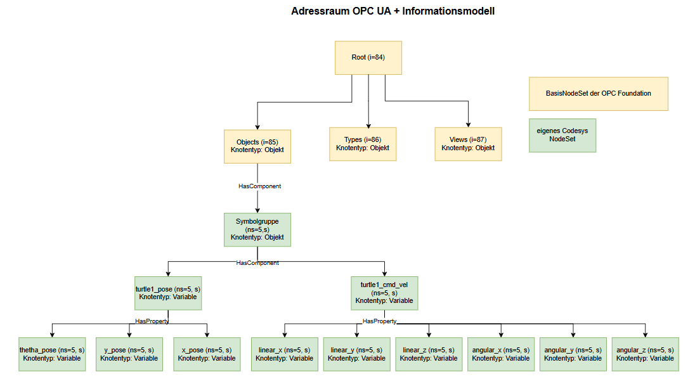
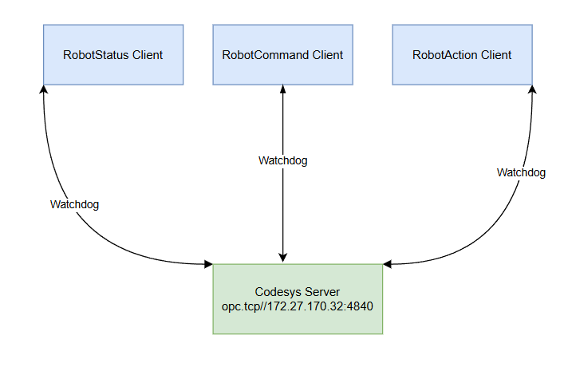
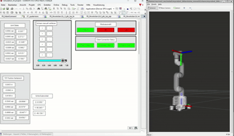
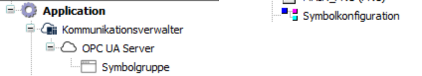

# Kommunikationsschnittstelle zwischen CODESYS und ROS 2 via OPC UA
Dieses Repository enthält eine Kommunikationsschnittstelle zwischen einer virtuellen CODESYS-SPS (vSPS) und ROS 2 Humble auf Basis von OPC UA. Die Schnittstelle wird zunächst an einem Minimalbeispiel mit turtlesim erläutert und anschließend auf die in ROS 2 simulierten Roboterarme myCobot 280 und xArm6 übertragen. Die Roboter werden über eine CODESYS-Visualisierung manuell verfahren (MoveIt Servo) oder über Bahnplanungsaufträge an MoveIt 2 automatisch bewegt.

# 0. Einrichtung der Entwicklungsumgebung:
## a: Entwicklungsumgebung
|Tool|Version|Befehl zum Prüfen|
|---|---|---|
|Host Betriebssystem|WIN11 25H2|winver|
|Subsystem|WSL2: Ubuntu-24.04 | wsl -l -v|	
|Container Plattform|Docker Desktop 4.88.1|docker version|	
|SPS Entwicklungsumgebung|Codesys Development V3.5 SP22 Patch 2|Codesys Installer |
|SPS Runtime| CODESYS Virtual Runtime for Linux SL|Codesys Installer|
|ROS Distribution	|ROS2 Humble| echo $ROS_DISTRO|
|Versionsverwaltung|git 2.43.0| git --version|


## b: Installation der Entwicklungsumgebung  
Eine ausführliche Anleitung befindet sich im Bericht!  
0. WSL2 einrichten
In Windows Power Shell als Administrator:
```
wsl --install -d Ubuntu-24.04
```
Beim ersten Start werden Benutzername und Kennwort festgelegt. Die installierte Version wird geprüft mit wsl -l -v.  
Der Netzwerkmodus ist standardmäßig auf NAT eingestellt, d.h. WSL und Windows haben unterschiedliche IP Adressen.
0.1 Für OPC UA wird später SSH benötigt:
```
sudo apt update && sudo apt install -y openssh-server
sudo systemctl enable ssh
sudo systemctl status ssh
```
1. Docker Desktop installieren
Nach der Installation von Docker Desktop muss unter Settings → Resources → WSL Integration die Integration für Ubuntu 24.04 aktiviert werden.

2. Dockerfile -> Image
Im Github liegt ein Dockerfile ab unter /Minimalbeispiel_Codesys_ROS2/ros2_ws/docker
```
docker build -t <image_name> mycobot280 --no-cache -f mycobot_dockerfile .
```
3. Image -> Container  
OPC IP anpassen!  
```
docker run -it \
  --name mycobot280 \
  --network=host \
  -e DISPLAY=$DISPLAY \
  - OPC_IP=172.21.225.150
  -v /tmp/.X11-unix:/tmp/.X11-unix \
  <image_name> \
```
4. Container starten mit:
```
docker start <container_name>
docker exec -it <container_name> bash
```

4. Codesys Projekt öffnen und mit Deploy Tool Container einrichten
Die Einrichtung mit dem Deploy Tool ist weiter unten ausführlich erklärt

# 1. Minimalbeispiel für Datenaustausch zwischen ROS2 und Codesys via OPC UA

Das Ziel ist es mithilfe von **turlesim** den Datenaustausch zwischen ROS2 und Codesys darzustellen und zu erlernen wie OPC UA dafür eingebaut und genutzt werden kann.
turtlesim ist ein Einsteigertool um ROS2 Konzepte zu erlernen.
Das Gesamtsystem besteht aus:
* ROS2 Simulation turtlesim
* OPC UA Brücke(asyncua)
* Codesys VSPS und Visualisierung

## a: Aufbau des OPC UA Adressraums
Der Adressraum ist folgendermaßen aufgebaut:


## b: Datenaustausch ROS2 Codesys
Für Datenaustausch zwischen ROS2 und Codesys gibt es generell 3 Möglichkeiten:
- Shared Memory (IPC) -> z.B: ROBIN Projekt
- Feldbusse (ModbusTCP, EtherCAT, ...)
- Netzwerkprotokolle (OPC UA, MQTT, rosbridge)
Entschieden für OPC UA, da industrieller Standard.


Die Topics aus ROS2 werden auf Structs in Codesys gemapped mit diesen dann der Adressraum aufgebaut wird.
Für die OPC UA Kommunikation wird das [opcua-asyncio](https://github.com/FreeOpcUa/opcua-asyncio) verwendet.

# c: Start des Minimalbeispiels
1. Stelle sicher das der ros2_ws korrekt gebaut wurde mit:
mit symlink install lassen sich python projekte ohne erneut bauen zu müssen ausführen!
```
cd ros2_ws
colcon build --packages-select minimalbeispiel_pkg --symlink-install
source install/setup.bash
```
2. Starten des OPC Servers in Codesys und Einloggen + Starten

3. Starten der turtlesim node und der kommunikations node in zwei separaten terminals
```
ros2 run turtlesim turtlesim_node
ros2 run minimalbeispiel_pkg opc_node 
```

# d: Übersicht des Minimalbeispiels
Beispielsvideo:  


In diesem Beispiel wird der Datenaustausch wird der Datenaustausch in beide Richtungen getestet:
Einmal von ROS2 -> Codesys: In diesem Fall wird die Position der Schildkröte übertragen und in Codesys angezeigt.
Dabei wird zunächst auf das topic /tutle1_pose subscribed und dann die variablen in die Itemliste geschrieben.
Codesys -> ROS2: Steuerung der Schildkröte mit Tastern
Dafür werden die Items in Variablenlsite beschrieben und bei Datenänderung dann von mit einer ros2 node gepublished.

# 2. Setup für OPC UA Verbindung
## a: Setup für CODESYS Virtual Control for Linux SL
### 1. Deploy Tool installieren 
Folgende Tools sind mit dem **Codesys Install Manager** zu installieren:
* 'CODESYS Virtual Control for Linux SL'
* 'CODESYS Control SL Deploy Tool'

### 2. Verbindung zu WSL herstellen (SSH)
SSH muss installiert und aktiviert sein unter WSL:
```bash
sudo apt update && sudo apt install -y openssh-server
sudo service ssh start
sudo service ssh status
``` 


### 3. Im Reiter **Bereitstellung** Images installieren
Folgende Images sind zu installieren:
* 'CODESYS Virtual Control for Linux SL Version 4.22.0(amd64)'
*  'CODESYS Virtual Edge Gateway for Linux Version 4.22.0(amd64)'


### 4. Im Reiter **Operation** Container starten


### 5. Codesys Laufzeit Sicherheitsrichtlinie anpassen um anonymes einloggen zu erlauben


### 6. Verbindung Device herstellen


# 3. Simulation MyCobot280

## a: Aufbau des transformations tree mycobot280
Um den Aufbau des Transformationen Baums zu sehen kann man folgendes tool verwenden:
tf2 übernimmt für uns die Arbeit der Transformationen!
```
ros2 run tf2_tools view_frames
```


## b: Aufbau OPC UA Clients
Aufteilung der OPC UA Kommunikation in drei OPC Clients.



**RobotStatus Client**:
- ist für den Datenaustausch ROS2 -> Codesys verantworlich. Client subscribed auf die Daten /joint_states und /tcp_pose und Daten werden dann an Codesys übertragen. Die Orientierung des TCP wird in ROS2 üblicherweise in Quaternions ausgegeben. Die Umrechnung von Quaternions -> Euler Winkel findet dann in Codesys statt.
**RobotCommand Client**:
ist für den Datenaustausch Codesys -> ROS2 verantwortlich. Dabei soll der Roboter manuell angesteuert werden. 
**RobotAction Client**:
ist für den Datenaustauch ROS2<->Codesys verantwortlich. Steuert RVIZ über MoveIt an! Dafür wird ein Action Client erstellt auf die /move_action.  

## c: Variablentypen ROS2 und IEC 61131-3
|**ROS2**|**IEC 66131-3**|
|---|---|
|Bool|BOOL|
|float64|LREAL|
|float32|REAL|
|int32|DINT|
|int16|INT|
|string|STRING|

# Beispielsvideo zur Steuerung der Visualisierung
## Manuelle Steuerung


## Automatik Steuerung mit Bahnplanung durch MoveIt
Im Rahmen der aktuellen Projektumsetzung können vier verschiedene Ansätze bzw. Konfigurationen für die Bahnplanung realisiert werden:

* **OMPL (Open Motion Planning Library):**
  * Standardmäßig wird hierbei der Algorithmus *RRT (Rapidly-exploring Random Tree)* verwendet
  * Die Planung kann wahlweise im Gelenkraum (*Joint Space*) oder im kartesischen Raum (*Cartesian Space*) erfolgen.

* **Pilz Industrial Motion Planner:**
  * Ermöglicht die Bahnplanung ebenfalls wahlweise im Gelenk- oder im kartesischen Raum.
  * Unterstützt die standardisierten PTP (*Point-to-Point*), LIN (*Linear*) und CIR (*Circular*).
  * *Hinweis zum Implementierungsstatus:* PTP Bewegungen funktionieren oft fehlerfrei.
  * LIN schlägt häufiger fehl da mit 6 achsen nicht jede position linear angefahren werden kann! Orientierung muss übereinstimmen!
  * Bei LIN Scaling auf ca. 0.005


# 4. Adressraum OPC UA
Es gibt zwei Möglichkeiten einen OPC Server zu erstellen mithilfe Codesys.  
Ab Codesys V3.5 SP18 empfiehlt CODESYS die Verwendung des Konfigurationseditors IEC Symbolkonfiguration.  

* Möglichkeit 1: Verwendung Kommunikationsverwalter + Symbolgruppe:  
Darstellung der NodeID nur in diesem Format möglich:
**ns=5;s=AQAAAKbhKnGK9zM6uvotdobvJ2ac8zBx6Q==**
* Möglichkeit 2: Verwendung Symbolkonfiguration
Darstellung der NodeID in folgendem gut lesbaren Format:
**ns=4;s=|var|CODESYS Virtual Control for Linux SL.Application.GVL_OPCUA.RobotCommand.axis_servo.axis_0** 

